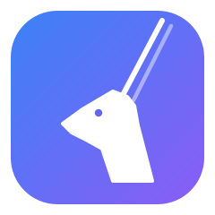
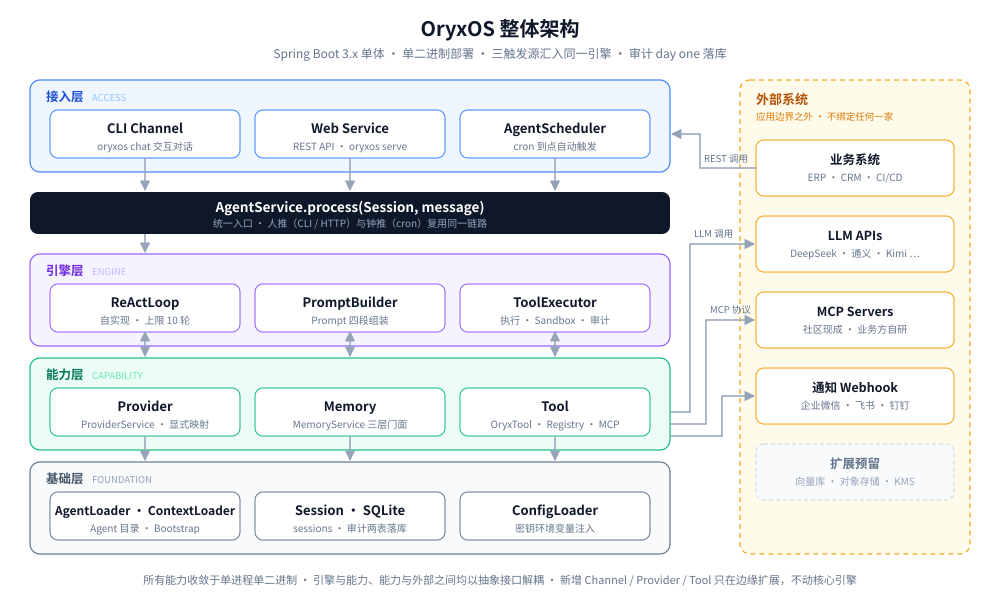

<div align="center">



# OryxOS

**Java 原生的企业级 Agent OS —— 私有部署、完全可审计的 Agent 统一底座**

[](LICENSE)
[](https://openjdk.org/)
[](https://spring.io/projects/spring-boot)
[](https://java2ai.com)

[English](README_EN.md) · 简体中文

</div>

---

## 什么是 OryxOS

OryxOS 是一个装在企业自己 K8s 或服务器上的 **Agent OS**：作为统一底座，在上面跑各种业务 Agent（运维助手、客服助手、HR 助手、销售助手、知识管理助手……），共享一套渠道接入、模型路由、工具调用、记忆系统、沙箱执行能力。

- **私有**：数据完全留在企业自己的基础设施，OryxOS 不收集任何企业数据，不锁任何云生态
- **统一**：多个业务 Agent 共享同一套底座，上一个新 Agent 写一个目录就能跑
- **易接入**：标准 Spring Boot 工程，与企业现有 ERP / CRM / CMDB / 监控体系直接对接
- **可观测**：结构化日志、健康检查、标准指标，纳入企业现有运维告警体系

> **Agent OS ≠ Agent Runtime**。Runtime 让一个 Agent 跑起来；Agent OS 让一群 Agent 在企业里被管起来——多 Agent 生命周期、统一接入、统一记忆、审计治理。

## 为什么做 OryxOS

业界已有开源 Agent OS 验证过这套设计（OpenClaw 用 Node.js、Hermes Agent 用 Python），但：

1. **Java 生态在这一层是空白**。Spring AI / LangChain4j 是框架（产物是代码），不是装好就跑的底座。企业的后端、ERP、CRM、SSO、监控大量是 Java 体系，跨技术栈的胶水是脆的。
2. **企业级治理没人做**。多租户、SSO、完整审计、Tool 治理——个人定位的项目不会 day one 设计这些，而银行、政府、电信这类严监管企业恰恰最需要。
3. **安全必须是 day one 设计**，不是事后补丁。凭证不落地、最小权限、沙箱隔离、全链路审计。

OryxOS 复用 Spring AI Alibaba 现成的十余个主流 LLM connector，把上面缺的"Agent OS"那一层补上。

## 核心能力

| 能力 | 说明 |
| --- | --- |
| 🔌 **对接 LLM** | Provider 抽象层对接 DeepSeek、通义、Kimi、智谱、混元、豆包、Anthropic、OpenAI 等主流模型，Agent 不感知具体是哪家，运行时切换无 lock-in |
| 🧠 **ReAct 循环** | 自实现的 Agent 核心循环：LLM 思考 → 调工具 → 看结果 → 再决策，多步骤任务一次对话内自主完成 |
| 💾 **三层记忆** | 会话记忆（SQLite 持久化、跨重启恢复）+ 长期记忆（MEMORY.md，Agent 主动读写）+ 情景记忆（扩展阶段） |
| 🛠️ **Tool 体系** | 9 个内置 Tool（文件 / Shell / HTTP / 记忆 / 通知推送）+ Plugin Tool 三档接入：零代码（Agent 目录 + 复用社区 MCP server）、轻代码（自写 MCP server）、重代码（Java `@Tool` Bean） |
| 🌐 **Web Service** | 完整 REST API 对外暴露所有能力，业务系统用 HTTP 即可接入——区别于个人助手项目的关键能力 |

外加：CLI 工具（12 个命令）、三种运行模式（`chat` / `serve` / `gateway`）、定时任务（cron 到点自动触发 Agent）、应用层 Sandbox 白名单。

## 快速开始

> ⚠️ **项目状态**：OryxOS 正处于核心阶段开发中（按 4 周节奏推进，见[路线图](#路线图)）。以下为核心阶段的目标用法，接口可能调整，欢迎 Star 关注或参与共建。

### 环境要求

- JDK 21+
- Maven 3.8+

### 构建与初始化

```bash
git clone https://github.com/<org>/oryxos.git
cd oryxos
mvn clean package

# 初始化工作区（生成 .oryxos/ 目录、Bootstrap 文件、默认配置）
java -jar oryxos.jar init

# 配置 LLM API Key（环境变量注入，不落明文）
export DEEPSEEK_API_KEY=sk-xxx
```

### 三种运行模式

```bash
# 交互式对话（开发调试、日常使用）
oryxos chat --profile <name>

# HTTP API 服务（业务系统集成，默认 :8080）
oryxos serve

# 多渠道守护进程
oryxos gateway
```

### REST API 一览（核心 10 端点）

```bash
curl -X POST localhost:8080/api/v1/sessions              # 创建会话
curl -X POST localhost:8080/api/v1/sessions/{id}/messages # 发消息
curl      localhost:8080/api/v1/sessions/{id}            # 查历史
curl -X POST localhost:8080/api/v1/agents/{name}/invoke  # 无状态调用
curl      localhost:8080/api/v1/profiles                 # 列 Agent
curl      localhost:8080/api/v1/tools                    # 列 Tool
curl      localhost:8080/api/v1/memory                   # 查长期记忆
curl      localhost:8080/api/v1/health                   # 健康检查
```

## 定义一个 Agent：一个目录

业务方**不写 Agent 后端代码**。定义一个 Agent = 写一个目录：

```
.oryxos/agents/daily-weather/
└── AGENT.md          # frontmatter（模型/工具/定时/通知渠道）+ 正文（任务指令）
```

```markdown
---
name: daily-weather
provider: { name: deepseek, model: deepseek-chat }
tools: [http_get, notify]
schedules: [{ cron: "0 0 8 * * *", message: "查北京天气并给穿搭建议" }]
notify_channels: [{ type: webhook, url: "${WECOM_WEBHOOK_URL}" }]
---
每天早上查询北京天气，生成穿搭建议，推送到运维群。
```

每天早上 8 点，Agent 自动完成：ReAct 循环 → 调 `http_get` 查天气 → 生成建议 → 调 `notify` 推送企业微信群。全程零 Java 代码。

目录还可以更丰富（渐进式披露，按需加载）：

```
agents/tech-digest/
├── AGENT.md                  # 光杆指令（天气 Agent 这一档）
├── skills/digest-format.md   # + 子指令：LLM 用 read_file 按需读
└── scripts/trending.py       # + 脚本：LLM 用 shell 跑，产出进上下文
```

接企业自有系统（ERP / CRM）？用任何语言写一个 MCP server，配进 `mcp_servers.yaml` 即可。

## 架构

OryxOS 是 Spring Boot 3.x 单体应用（Maven 9 模块，单二进制部署）：

<div align="center">



</div>

- **接入层**：CLI Channel、Web Service（REST）、AgentScheduler（cron）——三个触发源汇入同一个 `AgentService.process`
- **引擎层**：`ReActLoop` · `PromptBuilder` · `ToolExecutor`——Agent 的大脑
- **能力层**：Provider（LLM 调用）· Memory（三层记忆）· Tool（工具执行）
- **基础层**：Agent 目录 / Bootstrap 加载 · Session 存储 · SQLite · 配置密钥加载

技术栈：**JDK 21 + Spring Boot 3.x + Spring AI Alibaba + 自实现 ReAct loop + SQLite + Picocli**。

关键取舍：Spring AI 只做协议适配和 Schema 生成，Tool 调度完全由 OryxOS 自己掌控；审计数据（每次 LLM / Tool 调用）day one 落库。

## 路线图

| 阶段 | 内容 |
| --- | --- |
| **核心阶段**（进行中） | 运行时内核：五大核心能力 + CLI + 定时任务 + REST API，3 个每日自动 Demo 验收 |
| **扩展阶段** | 企业微信/飞书/钉钉 Channel、Provider fallback、Memory 向量检索、Tool Policy、容器级 Sandbox、Web 仪表板、SSO + 多租户、完整审计、集群高可用 |
| **社区共建** | Skills Marketplace、多语言 SDK、K8s Operator、可视化 Agent 编辑器、GraalVM Native Image |

远期三阶段：单机私有部署 → 底座分布式（多实例 + 外置状态）→ 分布式 Agent 协作（跨节点 Agent 互发现、互委托）。

## 生态关系

- **OpenClaw / Hermes Agent**：同类不同定位（个人/小团队 vs 企业），Skill 格式兼容 [agentskills.io](https://agentskills.io)，生态互补不竞争
- **Spring AI / Spring AI Alibaba**：复用关系——OryxOS 的 LLM 调用层直接站在其上
- **Dify / Coze 等编排平台**：互补关系——编排平台可以跑在 OryxOS 之上，把 OryxOS 当后端运行时

## 文档

| 文档 | 内容 |
| --- | --- |
| [业界调研](docs/IndustryResearch.md) | Agent OS 格局、Java 生态缺位、OryxOS 定位 |
| [需求文档](docs/DemandAnalysis.md) | 五大核心能力、功能分级、验收标准 |
| [技术方案](docs/TechnicalSolution.md) | 技术栈、关键决策、模块设计、数据模型 |
| [AI 编程指南](docs/AiProgrammingGuide.md) | Spec-Kit 实施拆解、AI 协作模式 |

## 参与贡献

OryxOS 以开源社区方式推进，扩展功能与社区共建功能（见路线图）都开放贡献：

1. 先读 [AGENTS.md](AGENTS.md)（项目级开发指南，含非协商技术原则）
2. 认领 issue（`good-first-issue` / `feature-request` / `long-term-goal`）
3. Fork → 开发 → 提 PR，遵守项目 constitution（JDK 21+、自实现 ReAct、审计落库等）

## License

[Apache License 2.0](LICENSE)
